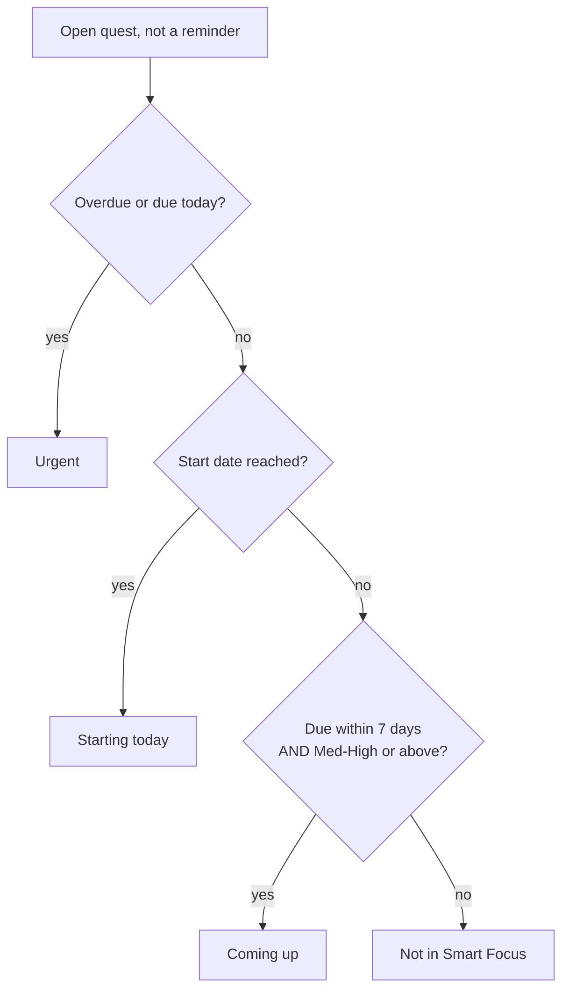

# Quest System — README

How quests work in ProductivityQuest: the three quest types, due dates vs start dates, the **Smart Focus** filter, the **Reminders** strip, and how all of it behaves in the other filters, the dashboard, CSV and recurring quests.

Companion file: [QUEST_SYSTEM_TEST_CASES.md](QUEST_SYSTEM_TEST_CASES.md) (manual + automated test cases).

---

## 1. The three quest types

Every quest has a type, chosen first when it is created and changeable later from the quest detail view.

| Type | Stored value | Meant for | Due date | Start date | Where it shows |
|------|--------------|-----------|----------|------------|----------------|
| **Deadline** | `deadline` | Something that has to be done by an exact date | **Required** | Optional | Smart Focus, Today, <3 Days, All, Type filter |
| **General to-do** | `general` | Worth doing, no hard deadline | Optional | Optional | Smart Focus (only when due/starting), All, Type filter |
| **Reminder** | `reminder` | Standing best practices and nudges, not work to schedule | Optional | Optional | **Reminders strip** (above the list in Smart Focus), All, Type filter |

- The default type is `general`. Quests created before types existed, imported from Notion, or imported from a CSV with no type column are general to-dos.
- Reminders never appear in Smart Focus, whatever their dates. They live in their own compact strip instead (section 4).
- The type shows as a small icon on quest cards, the calendar and the dashboard top-tasks list.

### Choosing and changing the type
- **Create:** the Add Quest dialog opens on a three-button chooser (Reminder / Deadline / General to-do). After choosing, the form shows a type badge and a **Change type** link.
- **Edit:** the quest detail view has a one-row, three-button selector. The current type is highlighted; clicking another saves immediately. Clicking the current type does nothing.

---

## 2. Due date vs start date

| Field | Meaning |
|-------|---------|
| **Due date** (`dueDate`) | The real deadline: when it has to be done by. |
| **Start date** (`startDate`) | "Start working on this from here." Controls when a quest begins to appear as a today item. |

A quest with **no start date** has no start-based behaviour, so quests that existed before start dates behave exactly as they did.

### Rules (enforced in the UI **and** by the server)

1. A **Deadline** quest must have a due date, on create and on edit.
2. Reminders and general to-dos may have no due date, no start date, or both.
3. The start date cannot be after the due date. Same day is fine; the comparison is by calendar day, so a start earlier in the day than the due time never counts as "after".
4. Switching an existing quest to Deadline needs a due date (already stored, or sent in the same edit).
5. A Deadline's due date can be changed but not cleared. For other types the due date can be cleared from the detail view.
6. If an edit moves **only the due date** to before the start date, the start date is pulled back to the new due date instead of failing (so bulk reschedules such as "move overdue to today" never break). If the edit explicitly sets a conflicting start date, it is rejected.
7. Edits that don't touch type, due date or start date are never blocked, even on older quests.

Violations return `400` with `{ "error": "<message>", "code": "INVALID_QUEST_DATES" }`. Messages:
- `A deadline quest needs a due date.`
- `The start date can't be after the due date.`

### Date storage convention
Dates are stored as the user's **calendar day at UTC midnight** (for example `2026-10-15T00:00:00.000Z`). "Today" is built the same way (`dayStart()` in `shared/quest-schedule.ts`), and dates are displayed using their UTC components so a stored day never shifts by a time zone.

### Entering dates
- **Add Quest:** Start Date and Due Date pickers. The due date shows a red asterisk only for Deadline. Start Date has shortcuts: **Today**, **Tomorrow**, **Next week**. Optional dates have a **Clear** button.
- **Quest detail:** separate Start Date ("Available now" when empty) and Due Date cards, each with an edit pencil. Optional dates have a **Clear** option. Server validation messages are shown in the error toast.

---

## 3. Smart Focus (the default quests filter)

Smart Focus answers "what should I work on today?". It is **not** a sorted copy of every quest. It only lists quests that qualify, capped at **10**.

### What qualifies

| Group | A quest is in it when | Sorted by |
|-------|-----------------------|-----------|
| **Urgent** | Overdue, or due today | Nearest due date, then importance, then start date |
| **Starting today** | Its start date has arrived (today or earlier) and it isn't already Urgent | Earliest start, then importance, then due date |
| **Coming up** | Due tomorrow through the next **7 days**, **and** importance is Med-High, High or Pareto | Nearest due date, then importance |

A quest that has started **and** is due soon is shown as *Starting today*, not *Coming up*.

### What is left out
- Quests with **no due date and no start date** (nothing to act on).
- Quests whose **start date is still ahead**, even if high priority.
- Quests due in the coming week that are **not** high priority (Medium, Med-Low, Low or none).
- Quests due **more than 7 days** away.
- **Reminders**, whatever their dates.
- Completed quests.

Everything left out is still reachable through **All**, **Upcoming**, **Today**, the Type filter and the other chips.



### The cap
- At most **10** quests are shown (`SMART_FOCUS_CAP`).
- Groups fill in order Urgent, then Starting today, then Coming up, so the cap trims the least pressing quests first.
- When more qualify than are shown, a line under the list says: *"Showing the top N of M. The rest are in the Today filter."*
- The **Smart Focus** chip count is the number actually shown.

### Empty state
When nothing qualifies, Smart Focus shows **"All clear for today"** with a hint to check Upcoming or All. It does not fill itself with other quests.

### Defaults and persistence
- Smart Focus is the default filter. The saved filter lives in `localStorage` under `tasksFilter-v2` (the v2 key resets everyone to Smart Focus once).
- Search applies inside Smart Focus before the rules and cap.
- The list-wide sort toggle (due date / importance) does not apply to Smart Focus; it has its own order.

---

## 4. Reminders strip

Reminders are general best practices, not hard tasks, so they don't compete with real work in Smart Focus.

- While **Smart Focus** is active, open reminders appear in a small collapsible strip directly **above the quest list**: a "Reminders" bar with a count, then titles in small (11px) text, wrapping to fit as many as possible (it scrolls if there are very many).
- **One click** on the bar collapses or expands the strip. The choice is remembered (`localStorage` key `remindersOpen`, open by default).
- Clicking a reminder title opens its detail view.
- Order: most important first, then nearest due date, undated last.
- The search box also filters the strip. The strip is hidden when there are no open reminders.
- Other filters (All, Today, Type > Reminder, ...) still list reminders as normal quests; the strip only exists in Smart Focus so they aren't shown twice.

---

## 5. Other filters and where start dates matter

| Chip / place | Behaviour |
|--------------|-----------|
| **Smart Focus** | Section 3. |
| **All** | Every open quest, including reminders and future-start quests. Uses the due date / importance sort toggle. |
| **Today** | Overdue, due today, **or** start date reached. Quests with no start date only qualify through their due date (unchanged from before). |
| **<3 Days** | Overdue or due within 3 days. Due date only. |
| **Upcoming** | Quests whose start date is still ahead, soonest first, then importance. |
| **Type menu** | Reminder / Deadline / General to-do, sorted by due date then importance. |
| **Quest cards** | Type icon; a small "Starts Oct 15" label while the start date is ahead. |
| **Dashboard top tasks** | Skips quests that haven't started yet and aren't due within 3 days; its tier ranking is otherwise unchanged. |
| **Today's momentum** | Counts open quests on Today's list (including start-reached ones) plus today's completions. |
| **Calendar** | Shows the type icon and a type badge on quest events. |

---

## 6. Recurring quests
When a recurring quest is completed it is rescheduled instead of archived. The due date moves forward by the recurrence period; the **start date moves by the same period**, so the lead time is kept, and it never lands after the new due date. A recurring quest with no start date stays without one. (`server/recurrence.ts`)

---

## 7. CSV import and export

- The quests CSV has **Quest Type** (after *Business/Work Filter*) and **Start Date** (right before *Due Date*) columns. Quest Type is written as its label (Reminder, Deadline, General to-do).
- Import reads columns **by header name**, so older CSVs without these columns still import (type defaults to general, no start date).
- Import accepts type labels or stored values, any case, with spacing ignored. Unknown or blank types become general.
- A **Deadline row with no due date** can't be saved, so it imports as a general to-do.
- A start date **after** the due date is dropped on import. Junk dates are ignored.
- **Completed rows are skipped** on import. Full exports now include completed quests (as history), and importing them must not revive finished work.
- **Settings > Export All as CSV** includes open **and completed** quests in `Tasks/tasks.csv`. (Completed quests are stored as archived rows; the export used to leave them out. Deleted quests are not exported.)
- Other Explore data (Countries, States, Activities in Cities, Food in Cities) is also in the Export All zip under `Travel/`.

---

## 8. Data model and migration

`tasks` table additions:

| Column | Type | Notes |
|--------|------|-------|
| `quest_type` | `text NOT NULL DEFAULT 'general'` | `reminder` \| `deadline` \| `general` |
| `start_date` | `timestamptz NULL` | Optional; **no backfill**, so existing quests have none |

Both columns are added by `ALTER TABLE ... ADD COLUMN IF NOT EXISTS` in `server/migrations.ts` (`runStartupMigrations`). A new column must be added there as well as in `shared/schema.ts`, or production breaks (see `DATABASE_MIGRATION_TEST_CASES.md`).

### API
- `POST /api/tasks` accepts `questType`, `startDate`, `dueDate` (ISO strings). Validation per section 2.
- `PATCH /api/tasks/:id` accepts the same; only edits touching type/due/start are validated against the stored quest.
- `GET /api/tasks/export/csv` returns open + completed quests.
- Notion sync is not used for start dates (the Notion integration is unchanged).

---

## 9. Where the code lives

| Concern | File |
|---------|------|
| Types, labels, parsing, importance rank | `shared/quest-type.ts` |
| Smart Focus rules, cap, Today list, reminders, validation | `shared/quest-schedule.ts` |
| Recurrence dates (due and start) | `server/recurrence.ts` |
| CSV build / parse | `server/tasks-csv.ts` |
| Create / edit validation, CSV routes | `server/routes.ts` |
| Export query (open + completed) | `server/storage.ts` (`getTasksForExport`) |
| Type chooser, badge, icon, 3-button selector | `client/src/components/quest-type-chooser.tsx` |
| Add Quest form (dates, type) | `client/src/components/add-task-modal.tsx` |
| Quest detail (type row, date cards) | `client/src/components/task-detail-modal.tsx` |
| Filters, Smart Focus view, reminders strip | `client/src/pages/home.tsx` |
| Dashboard top tasks / momentum | `client/src/pages/dashboard.tsx`, `client/src/hooks/use-today-momentum.ts` |

---

## 10. Tuning the rules

All numbers live in `shared/quest-schedule.ts`:

| Constant | Value | Effect |
|----------|-------|--------|
| `SMART_FOCUS_CAP` | 10 | Maximum quests in Smart Focus |
| `COMING_UP_DAYS` | 7 | How far ahead a high-priority due date counts |
| `URGENT_WINDOW_DAYS` | 3 | Window used by the dashboard top-tasks "not started yet" rule |
| `THIS_WEEK_DAYS` | 7 | Window used by that same rule |

"High priority" means importance Med-High, Pareto or High (`isHighPriority`).

---

## 11. Automated tests

```bash
npm run test:unit
```

| File | Covers |
|------|--------|
| `shared/quest-type.test.ts` | Types, labels, parsing, due-date-then-importance order |
| `shared/quest-schedule.test.ts` | Smart Focus qualification, groups, order, cap, empty state, reminders, Today list, Upcoming, date validation and edit rules |
| `server/tasks-csv.test.ts` | CSV columns, import/export, round trips, schemas |
| `server/recurrence.test.ts` | Recurring due and start dates |
| `client/src/components/quest-type-chooser.test.tsx` | Type chooser, badge, icons, 3-button selector |
| `shared/quest-docs.test.ts` | These docs stay in step with the code (constants, test-case count) |

Manual and API test cases: [QUEST_SYSTEM_TEST_CASES.md](QUEST_SYSTEM_TEST_CASES.md).
